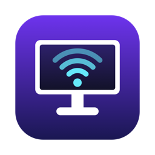

<p align="center"></p>

# MyMacMonitor

A small macOS menu-bar app that makes the Mac keyboard's **volume keys (F10 / F11 / F12)
control a Samsung Smart Monitor M9's built-in speakers**. It's a security-hardened fork of
[omarozt/M9Volume](https://github.com/omarozt/M9Volume).

> **Why a fork?** Before installing the original, I audited it. It was honest code, but it
> asked for more than it needed (it could see every keystroke, trusted any TLS certificate,
> and scanned any Wi-Fi network). This fork keeps the feature and removes the excess.
> Full report: **[SECURITY-AUDIT.md](SECURITY-AUDIT.md)**.

## The problem

Over USB-C/DisplayPort, macOS sends audio at a fixed level and greys out its volume
control. Samsung Smart Monitors (Tizen) don't support DDC/CI, so tools like MonitorControl
can't adjust them either. The monitor does accept the same Wi-Fi remote protocol Samsung TVs
use, and that's what this app speaks.

## What it does

- **F10 / F11 / F12** mute / lower / raise the monitor's volume, **but only while the
  monitor is the Mac's sound output.** With speakers or headphones selected, the keys control
  the Mac as usual.
- Menu-bar controls: volume, mute/unmute, OK / Back / Home / Power for the monitor's UI.
- Finds the monitor automatically on your home network and reconnects after sleep.
- Optional: auto-wake the monitor when the Mac wakes; Launch at Login.

## Security posture

| | Upstream | MyMacMonitor |
|---|---|---|
| Keyboard visibility | Every keystroke (`keyDown`) | Media keys only |
| Volume keys away from the monitor | Swallowed | Passed through to macOS |
| Monitor TLS certificate | Any cert accepted | Pinned on first use |
| Pairing token | World-readable (`0644`) | Owner-only (`0600`) |
| Network scanning | Any Wi-Fi | Only the network where the monitor lives |
| App Transport Security | Disabled | LAN-only exception |
| Auto-wake | On by default | Opt-in |
| Internet / telemetry | None | None |

## Requirements

- Apple Silicon Mac, macOS 13+ (tested on macOS 27.2)
- Samsung Smart Monitor M9 on the **same Wi-Fi/subnet** as the Mac
- Xcode or the Command Line Tools (`xcode-select --install`) to build. No Homebrew needed.

## Build & install

```sh
git clone https://github.com/GeRevolver/MyMacMonitor.git
cd MyMacMonitor
./build.sh      # compiles + ad-hoc signs into ~/Library/Caches/MyMacMonitor-build (installs nothing)
./install.sh    # copies to /Applications and opens it (explicit, separate step)
```

On first launch:
1. Grant **Accessibility** when macOS asks (needed to intercept the volume keys). The app
   relaunches itself.
2. Choose **Allow** on the monitor's pairing prompt.
3. Optional: *Settings… → Launch at Login*.

Do the first launch **on your home network**; that's the network the app will trust.

More: [docs/SETUP.md](docs/SETUP.md) (setup & troubleshooting) ·
[docs/PROTOCOL.md](docs/PROTOCOL.md) (Samsung/Tizen protocol notes).

## Uninstall

Quit from the menu, then:

```sh
rm -rf "/Applications/MyMacMonitor.app" ~/.mymacmonitor_token
defaults delete io.github.gerevolver.mymacmonitor
```

and remove it from *System Settings → Privacy & Security → Accessibility*.

## Credits & license

Original app and protocol research: [Omer Faruk Oztemiz](https://github.com/omarozt).
Security audit, hardening and rebrand: [Gerardo Espinosa](https://github.com/GeRevolver),
prepared with AI assistance (Claude Code) and tested on real hardware.
[MIT](LICENSE).
